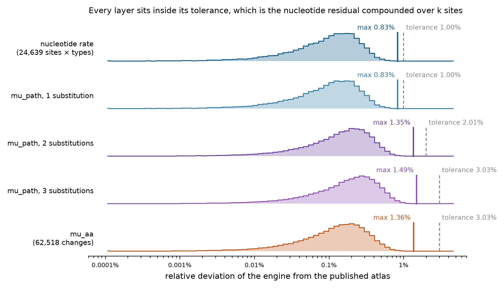
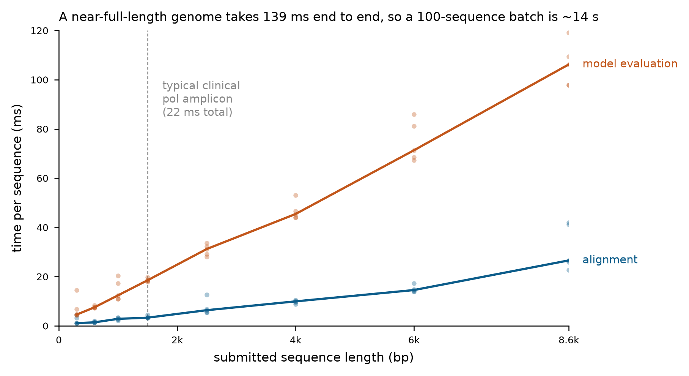

<!-- SPDX-License-Identifier: MIT -->
# Validation report — atlas v0.1

**Status: PASSED.** Date: 2026-10-28. Model:
`mra_joint_control_wt_nb_ga2_sub1_ga3_sum0_bio_splines`.

## The decisive test

> Run the custom-atlas engine on the NL4-3 reference sequence itself and reproduce the
> published NL4-3 atlas. Any discrepancy is a bug in the engine, not a modelling choice.

The reference is fed in exactly as a user would paste it, **alignment included**, so the
identity path through the aligner is tested too. An aligner that shifted the frame by one
base would otherwise go unnoticed while returning plausible, wrong numbers.

```bash
node test/roundtrip_nl43.mjs --version v0.1
python test/compare_roundtrip.py --version v0.1
```

Alignment of the reference to itself: identity 1.000, all 8,618 bases mapped, and
`queryToRef[j] == j` asserted for every base. Alignment 27 ms, engine
142 ms.

## Row counts

| Layer | Engine | Published | |
|---|---:|---:|---|
| nucleotide (position × substitution) | 24,639 | 24,639 | exact |
| codon → mutant-codon paths | 187,992 | 187,992 | exact |
| amino-acid changes | 62,518 | 62,518 | exact |

No engine-only and no published-only rows in any layer. Positions dropped for lying
outside the modelled region: 405 (= 8,618 − 8,213, as expected).
Spline fallback used at 0 positions, as it must be for a
sequence that aligns everywhere.

## Classifications — exact match required, no tolerance

These are categorical, so anything other than a perfect match is a bug.

| Field | Rows checked | Mismatches |
|---|---:|---:|
| `ref_nucleotide` | 24,639 | 0 |
| `context_3p` (incl. G→A 2-mer and its `OTHER` pooling) | 24,639 | 0 |
| `codon` | 187,992 | 0 |
| `n_nt_changes` | 187,992 | 0 |
| `mutation_type_path` | 187,992 | 0 |
| `ref_aa` | 62,518 | 0 |
| `aa_change` | 62,518 | 0 |
| `synonymous` | 62,518 | 0 |
| `min_nt_changes` | 62,518 | 0 |
| `n_paths` | 62,518 | 0 |

Also checked: all 24,639 identity rows
drew their 95% interval from the **published per-site** interval rather than the
type-context approximation (0
approximated). If that number is ever non-zero for an identity round-trip, the interval
lookup has stopped finding its entries.

## Rates — tolerance



| Quantity | n | max | p99 | tolerance |
|---|---:|---:|---:|---:|
| nucleotide `bio_rate` | 24,639 | **0.827%** | 0.454% | 1.000% |
| `bio_rate_lo95` | 24,639 | 0.824% | 0.454% | 1.000% |
| `bio_rate_hi95` | 24,639 | 0.826% | 0.454% | 1.000% |
| `mu_path`, 1 substitution | 26,856 | **0.827%** | 0.455% | 1.000% |
| `mu_path`, 2 substitutions | 80,568 | **1.346%** | 0.640% | 2.010% |
| `mu_path`, 3 substitutions | 80,568 | **1.488%** | 0.796% | 3.030% |
| `mu_aa` | 62,518 | **1.356%** | 0.624% | 3.030% |
| `mu_aa_lo95` | 62,518 | 1.359% | 0.623% | 3.030% |
| `mu_aa_hi95` | 62,518 | 1.352% | 0.623% | 3.030% |

Every row of every layer is within its tolerance.

### Why the amino-acid tolerance is larger than 1%, and why that is not a loosened standard

The brief recorded the nucleotide layer as reproducing the published rates to 0.83% and
noted that the amino-acid layer had no measured tolerance yet. Establishing it was part
of this test. It turns out not to be a free parameter.

A path rate is the **product** of *k* per-site rates. The nucleotide layer's residual is
Monte Carlo noise in the published posterior summaries — not model error and not engine
error — so over *k* sites it compounds multiplicatively:

```
tolerance(k) = (1 + 0.01)^k - 1   ->   1.00%, 2.01%, 3.03%  for k = 1, 2, 3
```

This was checked rather than assumed. For 6,000 sampled paths, the observed deviation of
`mu_path` equals the **sum of the per-site log deviations along that path** to a maximum
absolute difference of **1.08e-05** on the log scale, with correlation **0.99999954**.
The residual 1.08e-05 is the 6-significant-figure rounding of the shipped CSVs. In other
words the engine's path and summation arithmetic contributes no error of its own; all of
the observed deviation is inherited from the nucleotide layer.

Holding a 3-step path to the 1-step tolerance would be requiring the engine to be more
accurate than its inputs. The harness therefore asserts the derived bound
(`step_tolerance()` in `test/compare_roundtrip.py`), which is tied to the nucleotide
tolerance and cannot be quietly widened to accommodate a future bug.

`mu_aa` sums paths of 1, 2 and 3 substitutions, so every `mu_aa` row is judged at the
3-step bound regardless of its own `min_nt_changes`.

## Two findings that contradict the brief

Both were resolved in favour of the published tables, which are the acceptance criterion.

1. **`mu_aa` sums over all paths, not only minimal ones.** The brief says "the summed
   rate over every **minimal** nucleotide path". Measured against
   `aa_level_supply_table.csv`: summing all 1-, 2- and 3-step paths reproduces `mu_aa`,
   `mu_aa_lo95`, `mu_aa_hi95`, `n_paths` and `min_nt_changes` for all 62,518 rows
   exactly; restricting to minimal-step paths reproduces `n_paths` for only 23,718 of
   62,518 and shifts `mu_aa` by up to 0.40%. The engine sums all paths.

2. **Pooled context cells carry non-zero deltas that must not be applied.** Cells with
   fewer than 20 WT counts were fitted type-only: the model multiplies their context
   delta by zero, so the sampled value is prior-driven rather than zero — up to 0.0055 on
   the log scale, 0.55% in rate, which is over half the nucleotide tolerance. The model
   bundle did not record which cells were pooled, so a consumer had no way to know.
   `extract_mra_web_model.py` now emits `sub_context_pooled_cells`, derived from
   `sub_context_powered` in the site table so the script still depends on only its two
   inputs. The seven cells are `A->T|C`, `C->G|{C,G,T}`, `T->G|{A,C,T}`, which agrees
   with the brief's description.

## Alignment cases

`node test/align_cases.mjs` — all 8 cases pass.

| Case | What it pins down |
|---|---|
| the reference itself | identity 1, identity permutation, forward orientation |
| 5%-divergent pol fragment (ref 1,311–2,600) | placed at exactly the right reference span, whole query covered, no spline fallback |
| 9 bp insertion relative to the reference | the insertion is reported as unaligned **and reference positions downstream are unshifted** |
| nef amplicon straddling 8,213 | 405 positions dropped and counted; nef analysis stops at codon 72 |
| sequence entirely past 8,213 | aligns (reference is not trimmed before alignment) but yields zero rows, with the drop counted so the UI can explain itself |
| reverse-complemented paste | orientation detected, aligns at identity 1 |
| non-HIV junk | refused with a reason, not silently aligned |
| multi-FASTA parsing | line joining, headers, bare sequence with no header |

The pol-fragment case initially looked like a failure because 64 **Gag** codons were
analysed alongside 430 Pol codons. That is correct: reference 1,311–1,503 is the genuine
*gag–pol* overlap. The engine takes codon frames from the published path table rather
than re-deriving reading frames, which is why gene overlap and the *tat*/*rev* splice
junctions (one *rev* codon spans 2,325 nt) come out right without special cases.

## Performance



Median per sequence, 5 replicates at 5% divergence:

| Query length | Alignment | Model evaluation | Total |
|---:|---:|---:|---:|
| 300 bp | 1.1 ms | 4.6 ms | 5.7 ms |
| 1,500 bp (typical clinical pol amplicon) | 3.3 ms | 18.5 ms | 22 ms |
| 8,618 bp (near-full-length genome) | 26.6 ms | 106.2 ms | 139 ms |

`MAX_BATCH_SEQUENCES = 100` follows from this: ~14 s for 100 full-length genomes, ~2 s
for 100 pol amplicons, in a worker with progress reporting.

Two notes against the brief's expectations. First, a spurious band-edge detector was
making full-length alignment take 347 ms by forcing repeated re-runs at ever wider
bands; a query that legitimately covers the reference to its ends is not a clipped path.
Fixing that brought it to 27 ms. Second, with that fixed it is **model evaluation, not
alignment, that dominates** — a full genome enumerates 187,992 codon paths. Both are
far inside any interactive budget.

## What this test does NOT establish

- **Nothing about accuracy on a non-NL4-3 virus.** The round-trip shows the engine
  computes what the published model says; it cannot show the model transfers. Position
  effects were measured on NL4-3 and transfer only where an input aligns to it.
- **Interval coverage for novel (position, mutation type) pairs.** Where a submitted
  sequence carries a base NL4-3 does not have at that position, the published per-site
  interval does not exist and the engine applies the (type, 3' base) mean log-ratio.
  Within a type those ratios have SD 0.04–0.10, so the bound is right to roughly ±10%,
  but this is an approximation and every such row is flagged
  `interval_source = "type-context"`.
- **Indels.** Excluded from custom output by design: their predictor has no nucleotide
  context, so a "custom" indel rate is just the NL4-3 indel rate at that coordinate. They
  remain in the browse and download layer, where they are a real published result.
- **Joint uncertainty.** `mu_aa` intervals are the published marginal bounds pushed
  through the same product-and-sum arithmetic. They are useful for ranking and
  sensitivity, not as exact simultaneous credible intervals. This is inherited from
  `aa_level_supply_ci_methodology.txt`, not introduced here.

## Release gate

v0.1 does not go to anyone outside the lab until this report says PASSED for the assets
being shipped. Re-run both commands after any change to the engine, the aligner, the
extractor or the source tables, and treat an assertion failure as a hard stop.
